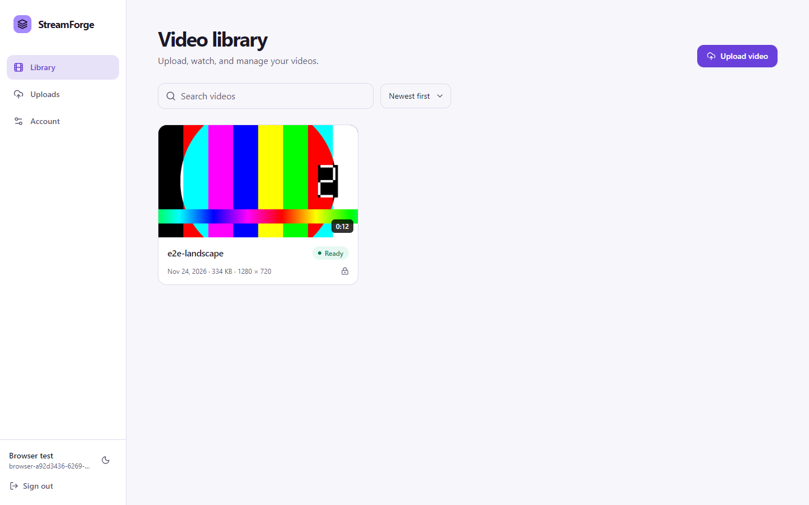
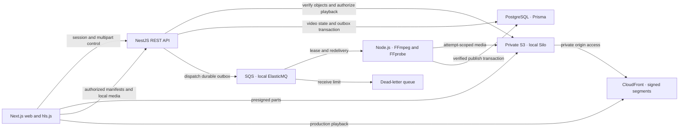

# StreamForge

StreamForge turns private video uploads into adaptive HLS streams. It gives each account a searchable library, resumable uploads, a browser player, and revocable unlisted links.

## Run locally

Use Node.js 22 LTS, pnpm 11, Docker Compose, and FFmpeg with `libx264` and `ffprobe`. The local services require no cloud account.

```sh
pnpm install --frozen-lockfile
cp .env.example .env
docker compose up -d
pnpm dev
```

On PowerShell, use `Copy-Item .env.example .env` in place of `cp` for a new checkout. The development command applies pending migrations and checks service readiness. Open the web app and register. Run `pnpm sample` to generate `artifacts/sample.mp4` for an upload. Open the video when it reaches **Ready**, then select a quality, seek, or create and revoke a share link. [Web app](http://localhost:3000)

## Screenshots



[Adaptive player](docs/screenshots/watch.png) · [Mobile upload recovery](docs/screenshots/uploads-mobile.png)

## Architecture



The pnpm and Turborepo workspace contains separate web, API, worker, and Prisma packages. The API verifies parts in storage before committing a job. A transactional outbox keeps the completion event durable through queue outages. Processing leases fence duplicate workers, and validated outputs become visible only after the database commits publication. Users see Uploading, Processing, Ready, and Failed.

## Checks and deployment

```sh
pnpm typecheck
pnpm lint
pnpm format:check
pnpm test
pnpm build
pnpm test:integration
pnpm exec playwright install chromium
pnpm test:e2e
```

Run the integration and browser commands while the local stack is running. See the [testing guide](docs/TESTING.md) for the database, DLQ, and load scenarios and their recorded results.

Production artifacts deploy the web app to Vercel and run the API and worker on ECS Fargate. Terraform prepares private S3, SQS and its DLQ, signed CloudFront delivery, an HTTPS load balancer, and IAM. This repository includes the deployment configuration and local development workflow. See [deployment prerequisites and rollback](docs/DEPLOYMENT.md).

- [Architecture and engineering tradeoffs](ARCHITECTURE.md)
- [Local development and troubleshooting](docs/LOCAL_DEVELOPMENT.md)
- [REST API](docs/API.md)
- [Security and privacy](docs/SECURITY.md)
- [Release verification and measurements](docs/RELEASE_CHECKLIST.md)
- [Monthly AWS cost model](docs/COST.md)

## Free public demo

Sign in, choose **Join demo queue**, and use a clip up to 20 MiB, 45 seconds, and 720p. The demo encodes one output up to 480p. The two-minute window begins after the output and its HLS artifacts are verified. Preview the stream and use the one-use private download to retrieve the original. [Code](https://github.com/DevPS326/StreamForge) ? [Live demo](https://stream-forge-flame.vercel.app/demo)

[Free-demo lifecycle, testing, and billing limits](docs/FREE_DEMO.md)
